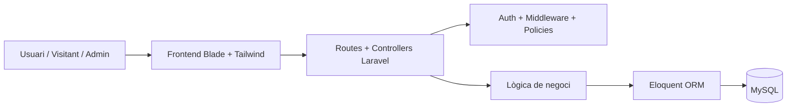
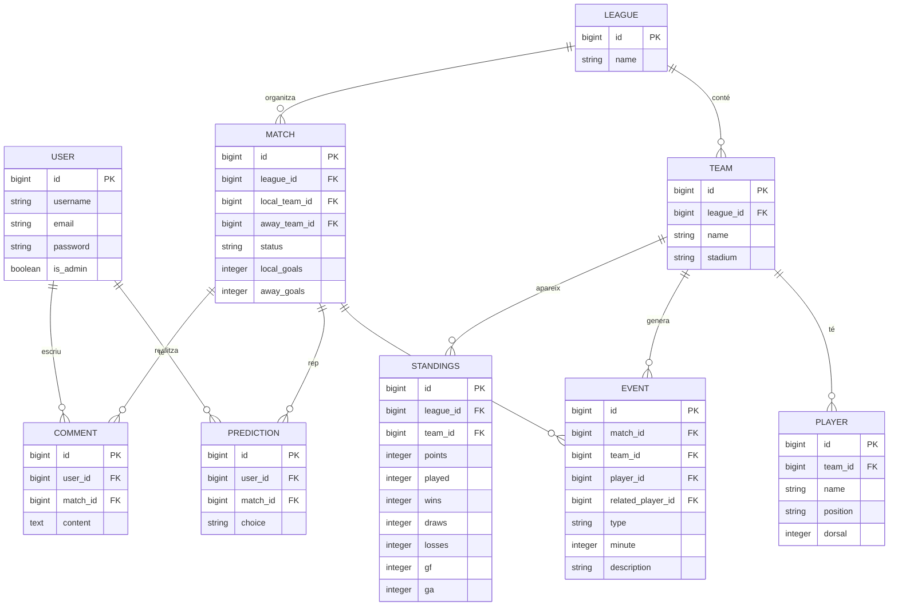

# Disseny del Sistema: MergeYGol

## 1. Introducció
MergeYGol és una aplicació web de seguiment de futbol inspirada en plataformes de telemetria esportiva com Sofascore. L'objectiu del sistema és oferir una visió ràpida i clara de partits, resultats, classificacions i estadístiques, amb una capa d'interacció comunitària basada en prediccions i comentaris.

La solució es basa en Laravel com a framework principal, Blade i Tailwind per a la interfície, i MySQL com a base de dades relacional. El disseny busca una arquitectura simple, escalable i fàcil de mantenir, separant la lògica de negoci, la capa de presentació i la persistència de dades.

---

## 2. Arquitectura

### 2.1. Capa de presentació
- Frontend amb Blade + Tailwind CSS.
- Vistes responsives per a mòbil i escriptori.
- Components reutilitzables per a la jornada, classificació, detall del partit i formularis d'administració.

### 2.2. Capa d'aplicació
- Arquitectura MVC de Laravel.
- Models per a les entitats del sistema.
- Controllers per a la lògica de cada funcionalitat.
- Routes per a l'accés públic i protegit.
- Middleware i policies per controlar permisos i autenticació.

### 2.3. Capa de persistència
- MySQL com a base de dades relacional.
- Eloquent per gestionar relacions entre entitats.
- Validació a nivell de model i controlador.

### 2.4. Seguretat
- Autenticació de Laravel.
- Contrasenyes protegides amb bcrypt.
- Accés restringit per rols i middleware d'administració.

---

## 3. Diagrama d'arquitectura

---

## 4. Diagrama E-R

---

## 5. Entitats principals

### 5.1. Usuari
- Gestiona l'autenticació i el perfil de cada compte.
- Pot ser visitant, usuari registrat o administrador.

### 5.2. Lliga
- Representa una competició.
- Agrupa equips i partits.

### 5.3. Equip
- Entitat principal del sistema.
- Conté dades bàsiques i es relaciona amb jugadors i classificació.

### 5.4. Jugador
- Guarda les dades de cada futbolista.
- Pot formar part de l'alineació i participar en esdeveniments.

### 5.5. Partit
- Defineix l'enfrontament entre dos equips.
- Inclou estat, marcador i data/hora.

### 5.6. Esdeveniment
- Registra accions com gols, assistències, targetes, tirs al pal, corners, faltes, remats, fora de joc o canvis de jugador.
- És la base de la cronologia del partit i també del càlcul d'estadístiques.
- Cada esdeveniment inclou minut, equip, jugador principal, jugador relacionat (si aplica) i descripció, per permetre una telemetria més rica i precisa.

### 5.7. Predicció
- L'usuari pot votar 1X2 per un partit.
- Es limita a un vot per usuari i partit.

### 5.8. Comentari
- Permet debatre i comentar el partit en directe.
- Lligat a usuari i partit.

### 5.9. Classificació
- Calcula punts i posicions dels equips.
- Es recalcula en finalitzar el partit.

---

## 6. Fluxos principals

### 6.1. Consulta de jornada
1. L'usuari accedeix a la pàgina principal.
2. El sistema mostra els partits del dia agrupats per competició.
3. Es presenta l'estat del partit, l'equip local, l'escut, el resultat i el minut.

### 6.2. Detall d'un partit
1. L'usuari entra a la fitxa del partit.
2. Es carrega alineació, timeline i estadístiques.
3. Es mostren comentaris i prediccions de la comunitat.

### 6.3. Votació 1X2
1. L'usuari autenticat selecciona 1, X o 2.
2. El backend valida la restricció d'un únic vot.
3. Es guarda la predicció i es recalculen els percentatges.

### 6.4. Gestió administrativa
1. L'admin gestiona equips, jugadors i partits.
2. Pot registrar esdeveniments durant el partit.
3. En finalitzar-lo, recalcula la taula de classificació.

---

## 7. Documentació bàsica de l'API

### 7.1. Convenis
- Base URL: /api
- Format de resposta: JSON
- Codis HTTP principals: 200, 201, 400, 401, 403, 404

### 7.2. Endpoints principals

#### Públics
- GET /api/matches
- GET /api/matches/{id}
- GET /api/teams/{id}
- GET /api/standings/{league_id}

#### Usuari autenticat
- POST /api/predictions
- GET /api/predictions/{match_id}
- POST /api/comments
- GET /api/comments/{match_id}

#### Administrador
- POST /api/admin/teams
- PUT /api/admin/teams/{id}
- POST /api/admin/matches
- POST /api/admin/matches/{id}/events
- POST /api/admin/matches/{id}/finish

---

## 8. Decisió de disseny
- Es mantenen relacions 1:N i N:N segons la naturalesa de cada entitat.
- La classificació i les estadístiques es calculen al backend per evitar inconsistències.
- Els esdeveniments es guarden en una taula independent per reconstruir la cronologia del partit i suportar múltiples tipus d'acció.
- El model d'esdeveniments s'ha de dissenyar com a taula genèrica amb camp `type`, `minute`, `team_id`, `player_id`, `related_player_id` i `description`, per permetre ampliar ràpidament el repertori d'accions sense alteracions massives del model.
- Les accions d'escriptura es restringeixen per rol.
- Es contemplen els casos d'esdeveniments amb impacte estadístic directe (gol, assistència, tir al pal, targeta) i els que només informen la cronologia del partit (corner, falta, fora de joc, canvi).

---

## 9. Conclusió
MergeYGol es planteja com una aplicació web de seguiment esportiu amb una estructura clara i modular. La combinació de Laravel, MySQL i Blade/Tailwind permet gestionar eficientment la consulta de dades, la interacció dels usuaris i la gestió administrativa, oferint un sistema coherent i ampliable per a futures funcionalitats.

